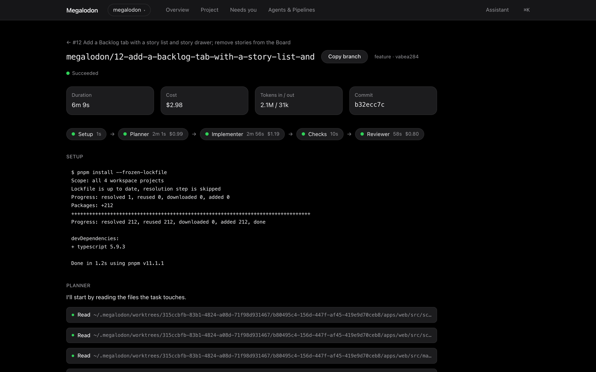
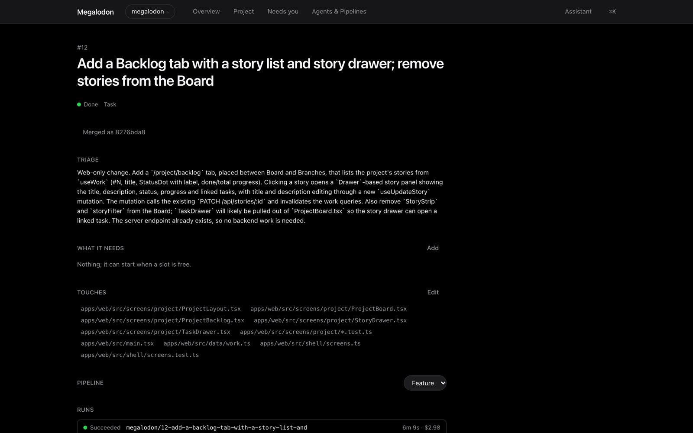
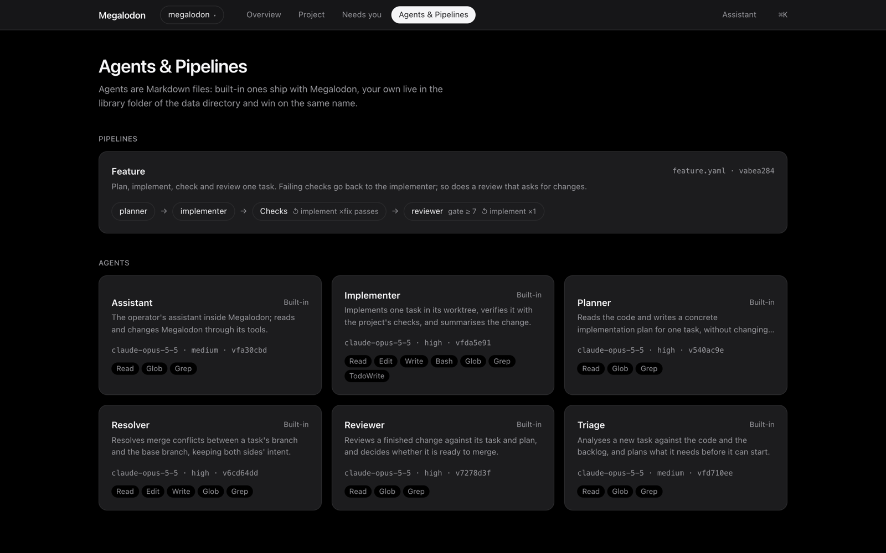
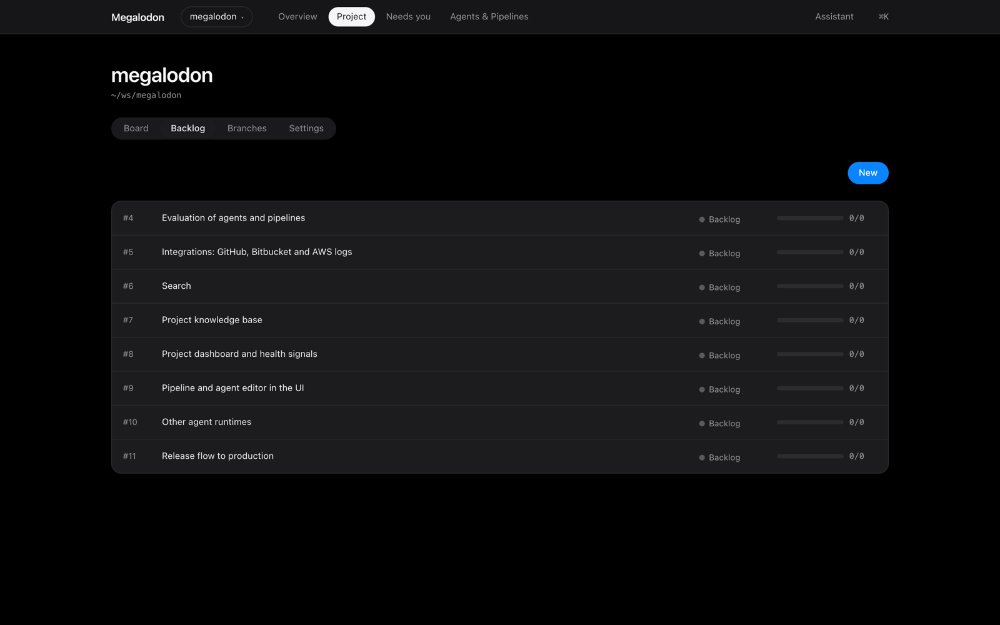
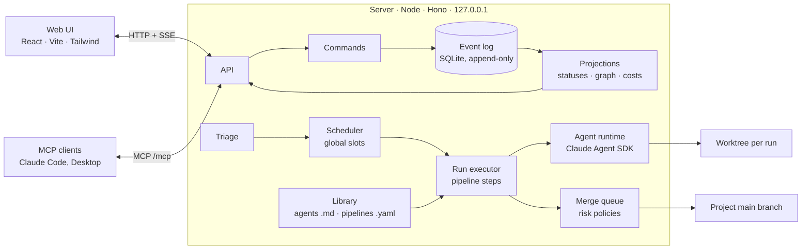

# Megalodon

[](https://github.com/pg013c/megalodon/actions/workflows/ci.yml)
[](LICENSE)

A local command centre for one developer who leads many software projects through AI agents: a
dependency-aware task queue, agent pipelines in isolated git worktrees, automatic merges gated by
policy, a full decision log, and one calm interface for all of it.



## The problem

One person supervises 5–10 projects, and AI agents do most of the implementation. The agents are
fast, but the human becomes the bottleneck: tasks live in one tool, agent sessions in terminals and
chat windows, branches in a git host, and the decisions agents made are nowhere. Every task needs
the human to start it, approve it, merge it and rebase whatever comes after it.

Megalodon takes that loop over. You drop work into a project; Megalodon works out what the task
depends on, runs it through an agent pipeline in its own worktree when its turn comes, and merges
it to `main` wherever the project's policy allows. You see every project at a glance, know exactly
what waits for you, can read every decision an agent made, and can overturn any of them.

## What it does

- **Task queue with a dependency graph.** A triage agent reads each new task against the code and
  the backlog, records what it touches and what it needs, and only then queues it. A global slot
  queue runs work across projects in order (ADR-0006, ADR-0007, ADR-0026).
- **Agent pipelines as files.** Agents are Markdown files and pipelines are YAML (plan → implement
  → checks → review, with retry loops and gates). Built-in definitions ship in `library/`; your own
  override them by name (ADR-0005).
- **Isolated worktrees.** Every run gets its own git worktree and branch. Agents never write to
  your checkout (ADR-0008, ADR-0024).
- **Merge queue with risk policies.** Finished branches are updated, re-checked and merged one at
  a time. Per project, each step is `auto`, `auto_if` (for example, a review score of at least 7)
  or `operator`, and anything held back lands in *Needs you* (ADR-0009, ADR-0027, ADR-0028).
- **Event log as the source of truth.** Every state change is an append-only event in SQLite;
  statuses, the graph, timelines and costs are projections rebuilt from it. Every agent decision is
  stored with its rationale and can be overridden (ADR-0003, ADR-0025).
- **Chat and an MCP server.** A built-in assistant can read and change Megalodon, and other
  clients (Claude Code, Claude Desktop) can use it over MCP at `/mcp` (ADR-0030).

| Task: triage summary, touch-set, pipeline, runs | Agents and pipelines from the library |
| --- | --- |
|  |  |



## How it works



Commands validate against projections and append events; nothing else writes. Rebuilding
projections from the log is covered by the test suite. More in
[`docs/ARCHITECTURE.md`](docs/ARCHITECTURE.md).

## It develops itself

The MVP was finished on 2026-10-26. Since then, changes to Megalodon have gone through Megalodon:
the operator writes a task, and the stable instance triages it, plans, implements, runs the checks,
reviews the change in a worktree and merges it into this repository.

As of 2026-11-02:

- 4 tasks went the whole way through the pipeline, and all 4 were merged by the merge policy, with
  no manual merge;
- 10 of the 22 commits in this repository were written by Megalodon's agents and merge queue
  (4 changes, 2 branch updates and 4 merges): look for `#N …` and `Merge #N …` in `git log`;
- 24 agent decisions are on record, at a total agent cost of $11.16.

The stable instance runs from a tagged release, so a merge into `main` never changes the
instance that made it; it is upgraded with a new tag (ADR-0013).

## Deep dive

- [`docs/PRD.md`](docs/PRD.md): the product, its user and principles.
- [`docs/CONCEPTS.md`](docs/CONCEPTS.md): vocabulary, statuses, dependencies and queue rules.
- [`docs/ARCHITECTURE.md`](docs/ARCHITECTURE.md): how it is built.
- [`docs/MVP.md`](docs/MVP.md): the build plan, step by step.
- [`docs/adr/`](docs/adr/): 31 architecture decision records.

## Running

Requires Node 22.13+ (for the built-in `node:sqlite`), pnpm 11, git, and credentials for the
Claude Agent SDK (a logged-in Claude Code or `ANTHROPIC_API_KEY`).

```bash
pnpm install
pnpm dev                 # dev instance from this checkout: server 4610, UI http://127.0.0.1:5610, data ~/.megalodon-dev
pnpm start               # this checkout built, served on 4610 with the dev data
git tag v0.1.0 && pnpm release v0.1.0   # build a release into ~/.megalodon/releases/v0.1.0
pnpm stable              # the stable instance: current release, http://127.0.0.1:4600, data ~/.megalodon
pnpm typecheck
pnpm test
```

Merges Megalodon makes into its own `main` never touch the stable instance; upgrade it with a
new tag and `pnpm release` (ADR-0013). Other clients can use Megalodon over MCP at
`http://127.0.0.1:4600/mcp` (ADR-0030).

Environment: `MEGALODON_PORT`, `MEGALODON_WEB_PORT` (dev UI), `MEGALODON_DATA_DIR`,
`MEGALODON_SERVE_WEB=1` (serve the built UI from the server).

## Status

A working MVP, used daily by its author: single user, local only (binds to `127.0.0.1`, no
authentication), Claude as the only agent runtime. Next on the backlog: evaluation of agents and
pipelines, GitHub and AWS integrations, search, and a per-project knowledge base.

## License

[MIT](LICENSE)
